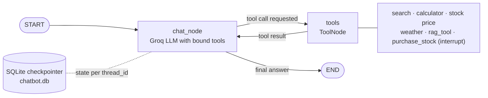
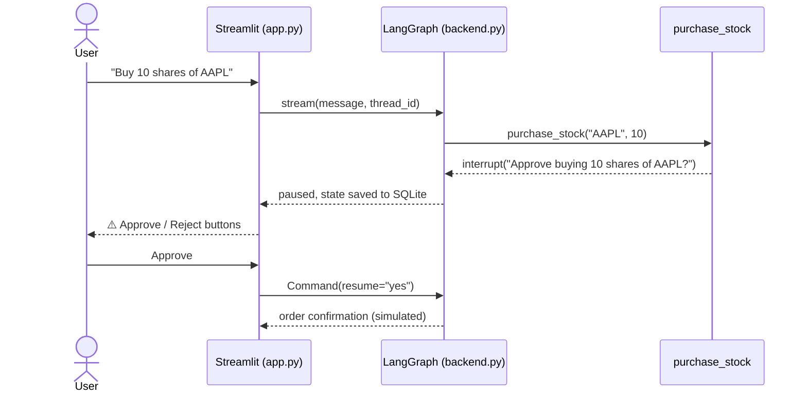
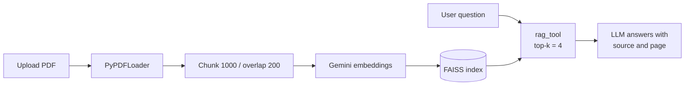
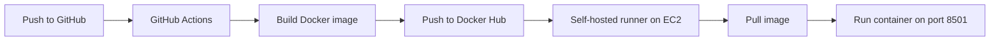

<div align="center">

# 🤖 Agentic Chatbot Using LangGraph

### A tool-using AI agent with PDF question answering (RAG) and Human-in-the-Loop approval, containerized with Docker and deployed on AWS EC2 through GitHub Actions


</div>

---

## 📌 Overview

This project is an **autonomous agent**, not a plain prompt-and-reply chatbot. The LLM decides for itself whether to answer directly or call a tool. It can search the web, do math, look up stock prices and weather, or answer questions from a PDF you upload.

The app also covers several things that most chatbot demos leave out:

- **Persistent conversations.** Each chat is a thread stored in SQLite, so history survives restarts and you can switch between threads from the sidebar.
- **Human-in-the-Loop (HITL) approval.** A sensitive action (a stock purchase) pauses the agent until a human clicks **Approve** or **Reject**. The approval request survives page refreshes.
- **Retrieval-Augmented Generation (RAG).** Upload a PDF in the chat box. It is chunked, embedded and indexed in FAISS, and the agent cites the source and page when it answers.
- **Observability.** Runs can be traced in LangSmith.
- **Containerized deployment.** A Docker image is built by GitHub Actions and deployed to an AWS EC2 instance.

---

## ✨ Features

|     | Feature                  | Details                                                                                                                                                            |
| --- | ------------------------ | ------------------------------------------------------------------------------------------------------------------------------------------------------------------ |
| 🧠  | **Tool-routing agent**   | A LangGraph `StateGraph` loops between the LLM and a `ToolNode` until the model has enough information to answer.                                                  |
| 🌐  | **Web search**           | Tavily search (advanced depth, top 5 results) for current events.                                                                                                  |
| 📄  | **Chat with PDFs (RAG)** | `PyPDFLoader` → recursive chunking (1000 / 200 overlap) → Gemini embeddings → FAISS. The `rag_tool` returns the top 4 chunks with page numbers.                    |
| 🧑‍⚖️  | **Human-in-the-Loop**    | `purchase_stock` calls LangGraph `interrupt()`. The graph pauses and state is saved, so the Approve / Reject buttons come back after a refresh or a thread switch. |
| 💾  | **Persistent memory**    | `SqliteSaver` checkpoints every step per `thread_id`.                                                                                                              |
| 🗂️  | **Multi-thread sidebar** | Start a new chat, reopen an old one, or switch threads and reload the full history.                                                                                |
| ⚡  | **Streaming responses**  | Tokens stream into the UI. A status box shows which tool is running.                                                                                               |
| 🌦️  | **Weather**              | Current conditions for any city (OpenWeather geocoding + current weather). Timeouts and HTTP errors are handled gracefully.                                        |
| 📈  | **Stock quotes**         | Latest global quote for a ticker (Alpha Vantage).                                                                                                                  |
| 🧮  | **Calculator**           | Expressions are evaluated with builtins disabled, so the LLM never does arithmetic by hand.                                                                        |
| 🔭  | **LangSmith tracing**    | Each run is tagged with its `thread_id` and named `chat_trace` or `hitl_resume_trace`.                                                                             |

---

## 🏗️ Architecture

### Agent graph



### Human-in-the-Loop flow



Because the paused state is stored in the checkpointer, the UI reads the pending approval from the database instead of keeping it in memory.

### RAG pipeline



---

## 🧰 Tech Stack

| Layer               | Technology                                                                                        |
| ------------------- | ------------------------------------------------------------------------------------------------- |
| Agent orchestration | LangGraph (`StateGraph`, `ToolNode`, `tools_condition`, `interrupt`, `Command`)                   |
| LLM framework       | LangChain (`langchain-groq`, `langchain-google-genai`, `langchain-tavily`, `langchain-community`) |
| LLM                 | Groq `openai/gpt-oss-20b` (temperature 0, low reasoning effort)                                   |
| Embeddings          | Google Gemini `gemini-embedding-001`                                                              |
| Vector store        | FAISS (saved to disk in `faiss_db/`)                                                              |
| Persistence         | `langgraph-checkpoint-sqlite` (`SqliteSaver`)                                                     |
| UI                  | Streamlit (chat, streaming, PDF attach in the chat input)                                         |
| External APIs       | Tavily, OpenWeather, Alpha Vantage                                                                |
| Observability       | LangSmith                                                                                         |
| DevOps              | Docker, Docker Hub, GitHub Actions (self-hosted runner), AWS EC2 (Ubuntu)                         |

---

## 🛠️ Agent Tools

| Tool                  | What it does                                                                | Backed by                 |
| --------------------- | --------------------------------------------------------------------------- | ------------------------- |
| `search_tool`         | Searches the web for current or recent information                          | Tavily                    |
| `calculator`          | Evaluates math expressions                                                  | Restricted `eval`         |
| `get_stock_price`     | Latest quote for a ticker such as `AAPL` or `TSLA`                          | Alpha Vantage             |
| `get_current_weather` | Temperature, feels-like, humidity, pressure, wind and visibility for a city | OpenWeather               |
| `rag_tool`            | Answers questions from the uploaded PDF, with source and page               | FAISS + Gemini embeddings |
| `purchase_stock`      | Simulated stock purchase that needs human approval first                    | LangGraph `interrupt()`   |

The system prompt tells the model when to use each tool. It also tells the model not to invent document content, and to ask for a PDF when none has been uploaded.

---

## 📁 Repository Structure

```text
.
├── app.py              # Streamlit UI: chat, sidebar threads, PDF upload, approve/reject
├── backend.py          # LangGraph agent: LLM, tools, RAG, HITL, SQLite checkpointer
├── requirements.txt    # Python dependencies
├── Dockerfile          # Container image for the app
├── LICENSE
└── README.md
```

Runtime files, such as `chatbot.db`, `faiss_db/` and `.env`, are created locally and should stay out of git (see `.gitignore`).

---

## 🚀 Run Locally

### 1. Clone and set up a virtual environment

```bash
git clone https://github.com/<your-username>/agentic-chatbot-using-langgraph.git
cd agentic-chatbot-using-langgraph

python -m venv .venv
source .venv/bin/activate          # Windows: .venv\Scripts\activate
pip install -r requirements.txt
```

### 2. Create a `.env` file

```env
# Chat LLM
GROQ_API_KEY=your-groq-api-key

# Embeddings for PDF RAG
GOOGLE_API_KEY=your-google-gemini-api-key

# Tools
TAVILY_API_KEY=your-tavily-api-key
OPENWEATHER_API_KEY=your-openweather-api-key
ALPHA_VANTAGE_API_KEY=your-alpha-vantage-api-key

# Tracing (optional)
LANGSMITH_TRACING=true
LANGSMITH_ENDPOINT=https://api.smith.langchain.com
LANGSMITH_API_KEY=your-langsmith-api-key
LANGSMITH_PROJECT=agentic-chatbot-project
```

| Variable                | Required            | Used for              |
| ----------------------- | ------------------- | --------------------- |
| `GROQ_API_KEY`          | ✅                  | The chat model        |
| `GOOGLE_API_KEY`        | ✅ for PDF upload   | Gemini embeddings     |
| `TAVILY_API_KEY`        | ✅ for web search   | `search_tool`         |
| `OPENWEATHER_API_KEY`   | ✅ for weather      | `get_current_weather` |
| `ALPHA_VANTAGE_API_KEY` | ✅ for stock quotes | `get_stock_price`     |
| `LANGSMITH_*`           | ❌                  | Tracing               |

### 3. Start the app

```bash
streamlit run app.py
```

Open http://localhost:8501.

### 💡 Things to try

| Prompt                                               | Expected behavior                         |
| ---------------------------------------------------- | ----------------------------------------- |
| `What is 1234 * 5678 + sqrt(144)?`                   | Calls `calculator`                        |
| `What's the weather in Mumbai right now?`            | Calls `get_current_weather`               |
| `Latest price of TSLA?`                              | Calls `get_stock_price`                   |
| `Latest news about open-source LLMs`                 | Calls `search_tool`                       |
| Attach a PDF, then ask `Summarise the main findings` | Calls `rag_tool` and cites pages          |
| `Buy 5 shares of AAPL`                               | Pauses and shows **Approve** / **Reject** |

---

## 🐳 Run with Docker

```bash
docker build -t agentic-chatbot .
docker run -d --name agentic-chatbot -p 8501:8501 --env-file .env agentic-chatbot
```

The app is then available at http://localhost:8501.

---

## ☁️ Deployment: GitHub Actions to AWS EC2

Each push builds the Docker image, pushes it to Docker Hub and redeploys it on an EC2 instance through a self-hosted GitHub Actions runner.



### 1. AWS setup

1. **Create an IAM user for deployment** and attach the `AmazonEC2FullAccess` policy. Use its access keys for the pipeline.
2. **Launch an Ubuntu EC2 instance.** In its security group, allow inbound traffic on port **8501**.

### 2. Install Docker on the EC2 instance

Connect to the instance over SSH, then run:

```bash
sudo apt-get update -y
sudo apt-get upgrade -y

curl -fsSL https://get.docker.com -o get-docker.sh
sudo sh get-docker.sh
sudo usermod -aG docker ubuntu
newgrp docker
```

### 3. Register the EC2 instance as a self-hosted runner

In the GitHub repository, go to **Settings → Actions → Runners → New self-hosted runner**. Choose Linux, then run the displayed commands on the EC2 instance one at a time.

### 4. Add the repository secrets

Go to **Settings → Secrets and variables → Actions → New repository secret** and add:

| Secret                  | Value                                 |
| ----------------------- | ------------------------------------- |
| `REGISTRY`              | `docker.io`                           |
| `DOCKER_USERNAME`       | Your Docker Hub username              |
| `DOCKER_PASSWORD`       | A Docker Hub access token             |
| `IMAGE_NAME`            | `agentic-chatbot`                     |
| `AWS_ACCESS_KEY_ID`     | Access key of the deployment IAM user |
| `AWS_SECRET_ACCESS_KEY` | Secret key of the deployment IAM user |
| `AWS_REGION`            | `us-east-1`                           |
| `GROQ_API_KEY`          | Groq API key                          |
| `GOOGLE_API_KEY`        | Google Gemini API key                 |
| `TAVILY_API_KEY`        | Tavily API key                        |
| `OPENWEATHER_API_KEY`   | OpenWeather API key                   |
| `ALPHA_VANTAGE_API_KEY` | Alpha Vantage API key                 |
| `LANGSMITH_TRACING`     | `true`                                |
| `LANGSMITH_ENDPOINT`    | `https://api.smith.langchain.com`     |
| `LANGSMITH_API_KEY`     | LangSmith API key                     |
| `LANGSMITH_PROJECT`     | `agentic-chatbot-project`             |

> 🔐 API keys belong in GitHub secrets or a local `.env` file. Never commit them.

Once the pipeline has run, the app is reachable at `http://<EC2-public-IP>:8501`.

---

## 🧠 Design Decisions

- **A graph instead of a fixed chain.** The `chat_node ⇄ tools` cycle lets the model call several tools in turn and reason over the results before it replies.
- **The checkpointer is the source of truth.** Chat history and paused approvals are read from SQLite, not from UI state. That is what makes thread switching and refresh recovery work.
- **Tools fail with readable messages.** Errors such as a missing key, a timeout or a bad API response come back to the LLM as text, so the graph keeps running.
- **Safe math.** The calculator runs `eval` with no builtins and a small allow-list.

---

## 🗺️ Roadmap

- [ ] Support several PDFs per user and separate indexes per thread
- [ ] Replace the simulated purchase with a brokerage sandbox API
- [ ] Move conversation storage to Postgres
- [ ] Add tests for tool routing and HITL resume
- [ ] Put HTTPS in front of the app (Nginx or an AWS load balancer)

---

## 👤 Author

**Ronik Agrawal**: [@ronikagrawal85](https://github.com/ronikagrawal85)

## 📄 License

See [LICENSE](LICENSE).
